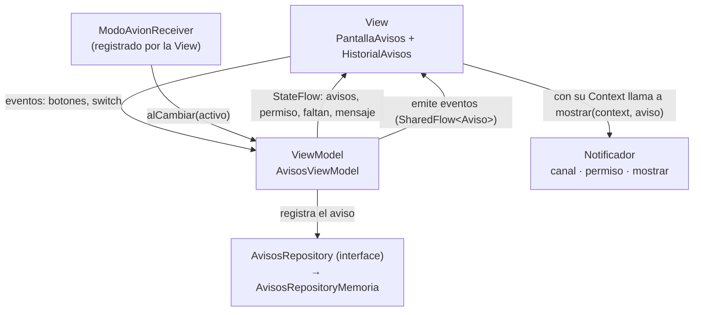
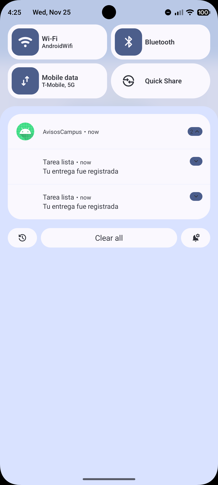
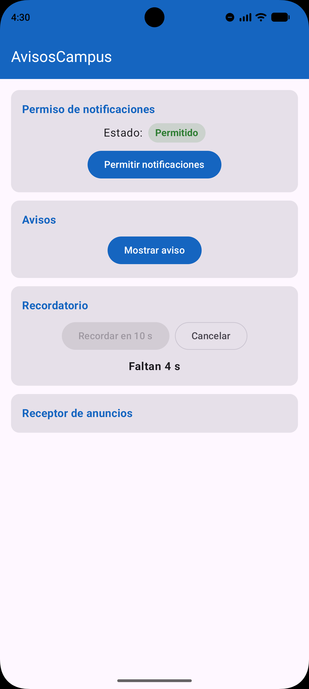
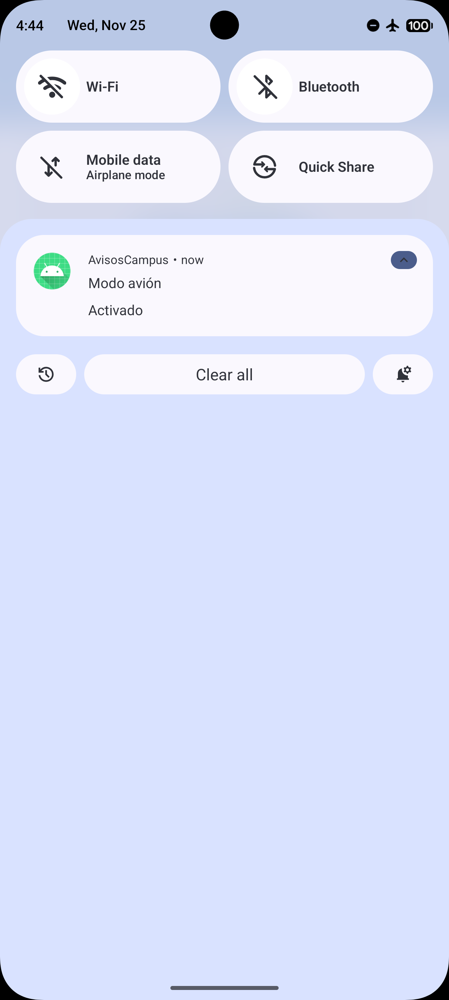
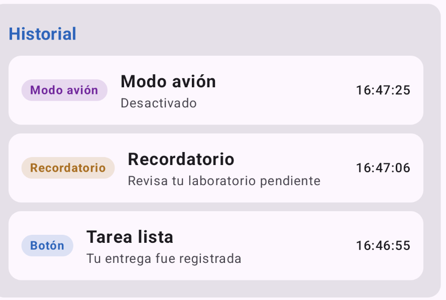
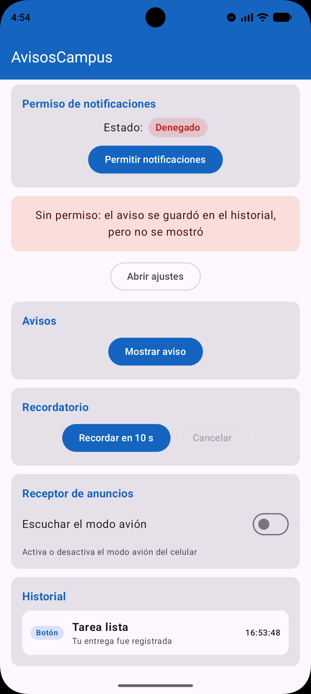

# AvisosCampus

App Android que **muestra notificaciones** y **escucha lo que pasa en el celular**. Con un botón muestra un aviso, con otro programa un **recordatorio** que llega a los 10 segundos y, si el usuario lo activa, avisa cuando se **enciende o apaga el modo avión**. Todo queda anotado en un **historial**.

Laboratorio 15 · Programación en Móviles · Tecsup
Alumno: Guillermo Willard Castillo · Docente: Juan León S.

| Dato | Detalle |
|---|---|
| Tecnología | Kotlin + Jetpack Compose + Material 3 (sin XML) |
| Patrón | MVVM + Repository (interface) |
| Temas | Canal de notificación, permiso `POST_NOTIFICATIONS`, `NotificationCompat`, `PendingIntent`, corrutinas, `BroadcastReceiver` |
| Probado en | Emulador con Android 13 o superior (API 33+) |
| Ramas | `main` (Fase 1) y `mejora-ia` (Fase 2 con Gemini) |

## Estructura de paquetes

```
com.willard.avisoscampus/
├── AvisosApp.kt                  Application: crea el canal al iniciar
├── MainActivity.kt               Crea el ViewModel con su Factory
├── model/
│   └── Modelos.kt                Aviso, Origen, PermisoUi
├── data/
│   └── AvisosRepository.kt       interface + AvisosRepositoryMemoria
├── notificacion/
│   └── Notificador.kt            canal, permiso y mostrar la notificación
├── receiver/
│   └── ModoAvionReceiver.kt      BroadcastReceiver del modo avión
├── viewmodel/
│   ├── AvisosViewModel.kt        estado (StateFlow) y eventos (SharedFlow)
│   └── AvisosViewModelFactory.kt
└── ui/
    ├── PantallaAvisos.kt         tarjetas, permiso, receptor y eventos
    ├── HistorialAvisos.kt        lista de avisos (no conoce al ViewModel)
    └── theme/
```

## Diagrama MVVM



**La idea clave:** el ViewModel decide qué avisar y lo anota en el Repository; después emite un evento. La pantalla lo recibe y, como sí tiene `Context`, llama al `Notificador`. Así el ViewModel nunca toca el sistema de notificaciones y se puede probar sin Android.

## Capturas

| Notificación en el panel | Recordatorio |
|---|---|
|  |  |

| Modo avión | Historial | Permiso denegado |
|---|---|---|
|  |  |  |

## Pruebas de aceptación (Fase 1)

| Prueba | Resultado esperado | OK |
|---|---|---|
| Ajustes → Apps → AvisosCampus → Notificaciones | Existe el canal **Avisos** | ✅ |
| Pulsar **Permitir notificaciones** | Aparece el cuadro de Android y la etiqueta cambia | ✅ |
| Pulsar **Mostrar aviso** | Aparece la notificación **Tarea lista** | ✅ |
| Pulsar **Mostrar aviso** dos veces | Aparecen dos notificaciones distintas | ✅ |
| Tocar la notificación | Se abre la app y la notificación desaparece | ✅ |
| Recordar en 10 s | Cuenta regresiva y aviso al llegar a 0 | ✅ |
| Recordar y minimizar la app | El aviso llega igual | ✅ |
| Recordar y cancelar | No llega ningún aviso | ✅ |
| Switch activado y cambiar el modo avión | Aviso **Activado** y luego **Desactivado** | ✅ |
| Switch desactivado y cambiar el modo avión | No hay aviso | ✅ |
| Permiso denegado y **Mostrar aviso** | Mensaje de error, aviso en el historial y la app no se cierra | ✅ |
| Rotar la pantalla durante el recordatorio | La cuenta regresiva continúa | ✅ |
| Revisar el código | No hay `Context` en `viewmodel/` y todo receptor se quita en `onDispose` | ✅ |

## Para pensar

**1. ¿Por qué una notificación necesita un canal y un permiso? ¿Qué pasa si falta cada uno?**
El **canal** (Android 8+) agrupa las notificaciones por tipo para que el usuario controle cada categoría (sonido, importancia, apagarla) desde Ajustes. Si falta, en Android 8+ la notificación simplemente no se muestra. El **permiso** `POST_NOTIFICATIONS` (Android 13+) es el consentimiento del usuario para recibir notificaciones de la app. Si no se declara en el Manifest o el usuario lo niega, `notify()` no muestra nada; por eso `Notificador.mostrar()` revisa el permiso antes y devuelve `false`.

**2. ¿Por qué el ViewModel emite un evento y no muestra la notificación él mismo?**
Para mostrarla se necesita un `Context`, y el ViewModel no debe tenerlo: vive más que la Activity (sobrevive a la rotación), así que guardar un `Context` filtraría memoria. Además, sin dependencias de Android se puede probar con una prueba unitaria simple. Se usa un `SharedFlow` porque "muestra esta notificación" es un evento de una sola vez; con un `StateFlow`, al rotar la pantalla se volvería a mostrar.

**3. ¿Qué pasa si usas el mismo id en dos notificaciones?**
La segunda **reemplaza** a la primera en vez de sumarse. Eso sirve para actualizar una notificación (por ejemplo, una barra de progreso), pero aquí queremos avisos distintos; por eso cada uno usa `aviso.id`, que el Repository incrementa.

**4. ¿Por qué `onReceive` debe ser corto y por qué hay que quitar el receptor al salir?**
`onReceive` corre en el hilo principal y Android le da muy poco tiempo; si hace trabajo largo bloquea la interfaz y puede provocar un ANR. Por eso solo lee el dato y lo pasa al ViewModel. Hay que quitar el receptor porque, si no, sigue registrado con la Activity vieja: se filtra memoria y sigue recibiendo anuncios aunque la pantalla ya no exista. En la app se registra y se quita con `DisposableEffect`/`onDispose`.

**5. ¿En qué casos usarías una notificación local y en cuáles una push de Firebase?**
**Local:** cuando el evento ocurre en el propio celular y la app ya lo sabe, como un recordatorio, un temporizador o un cambio del sistema (modo avión, cargador). No necesita internet ni servidor. **Push (FCM):** cuando el evento nace en un servidor o en otra persona, como un mensaje nuevo, el estado de un pedido o un anuncio para todos los alumnos. Llega aunque la app esté cerrada.

## Decisiones técnicas

- **Paquete `com.willard.avisoscampus`** en lugar de `com.tecsup.avisoscampus`: es el paquete personal que uso en los laboratorios.
- **`lifecycle-viewmodel-compose` con la misma versión de lifecycle del proyecto** (2.11.1) en lugar de la 2.8.7 de la guía, para no mezclar versiones del mismo grupo en el catálogo `libs.versions.toml`.
- **Intent con `FLAG_ACTIVITY_CLEAR_TOP | FLAG_ACTIVITY_SINGLE_TOP`**: al tocar la notificación con la app abierta reutiliza la pantalla existente en vez de apilar otra `MainActivity` con un ViewModel nuevo (y el historial vacío).
- **`Abrir ajustes` con verificación de versión**: `ACTION_APP_NOTIFICATION_SETTINGS` existe desde Android 8 y el `minSdk` es 24; en versiones anteriores abre los detalles de la app.

## Guía rápida para la sustentación

| Tema | Dónde está |
|---|---|
| Crear el canal una sola vez | `AvisosApp.kt:9` → `notificacion/Notificador.kt:22` |
| Declarar el permiso | `AndroidManifest.xml:5` |
| Revisar el permiso | `notificacion/Notificador.kt:36` |
| Pedir el permiso en tiempo de ejecución | `ui/PantallaAvisos.kt:60` |
| Guardar la respuesta del permiso | `viewmodel/AvisosViewModel.kt:37` |
| Construir y mostrar la notificación | `notificacion/Notificador.kt:45` (id único en la línea 67) |
| PendingIntent para abrir la app | `notificacion/Notificador.kt:51` |
| Evento de una sola vez (SharedFlow) | `viewmodel/AvisosViewModel.kt:24` |
| La pantalla recibe el evento y notifica | `ui/PantallaAvisos.kt:73` |
| Recordatorio con corrutina y `finally` | `viewmodel/AvisosViewModel.kt:49` y `:63` |
| Cancelar el recordatorio | `viewmodel/AvisosViewModel.kt:69` |
| Receptor corto del modo avión | `receiver/ModoAvionReceiver.kt:9` |
| Registrar y quitar el receptor | `ui/PantallaAvisos.kt:79`, `:82` y `:88` |
| Historial (los 20 más recientes) | `ui/HistorialAvisos.kt:22` y `:30` |
| Permiso denegado: mensaje y Abrir ajustes | `viewmodel/AvisosViewModel.kt:90` y `ui/PantallaAvisos.kt:138` |
